# Product Design Orchestrator

Interactive workflow for product and feature design -- from fuzzy idea to development-ready product brief. Phases adapt based on detected design characteristics (greenfield vs enhancement, simple vs complex, UI-focused vs backend). Uses a hybrid interaction architecture: agents for unbiased generative work, inline interactive phases for convergent and evaluative work. Visual companion renders HTML/CSS mockups in a browser for rich design feedback.

## Initialization

**BEFORE executing any phase, you MUST complete these steps:**

### Step 0: Session-reminder conflict resolution (decide ONCE)

Before doing anything else, settle this policy now and do not re-litigate it at any gate:

**`→ MANDATORY GATE` markers fire regardless of session-reminders, permission mode, or prior approval patterns.** Auto / accept-edits / dangerously-skip-permissions modes, reminders saying "work without stopping" / "continue without asking" / "minimize clarifying questions," and compaction summaries showing the user approving every prior gate do NOT exempt you from invoking `ask_question` at a gate. They apply only to your discretionary clarifications.

If you find yourself reasoning "the user has been approving everything, so I can skip this gate" or "auto-mode is on, so I should minimize questions" — that reasoning IS the failure mode. STOP and fire the gate.

Full framework rule: `../orchestrator-framework/references/orchestrator-patterns.md` § 2 and § 2.1.

### Step 1: Load Framework Patterns

**Read the framework reference file NOW using `read_file`:**

1. `../orchestrator-framework/references/orchestrator-patterns.md` — Delegation rules (`invoke_subagent` & skill `SKILL.md` execution), mandatory `ask_question` gates, state schema, `update_steps` initialization, context passing, issue resolution
2. `references/workflow-phases.md` — Complete step-by-step instructions, gates, prompts, and state updates for every phase of this orchestrator (MANDATORY: read this file in full before executing Phase 1)

### Step 2: Detect Design Context

**If argument is a design task path** (matches `.maister/tasks/product-design/*`):
- This is a resume — read `orchestrator-state.yml` from that path
- Determine current phase from `completed_phases` and resume from next phase
- If `--from=PHASE` provided, resume from that specific phase

**If `--research=<path>` flag provided**:
- Read research artifacts from specified path (report, synthesis, solution exploration)
- Copy relevant context to `context/research-context/`
- Set `research_reference` in state

### Step 3: Initialize Workflow

1. **Capture the clock**: run `date -u +"%Y-%m-%dT%H:%M:%SZ"` via `run_command` NOW — you do NOT know the time from context. Every timestamp written this turn (`created`, `updated`, `generated`, `phases[].started`) uses this value. Date-only or `T00:00:00Z` values are the documented failure mode (orchestrator-patterns.md § 4 Timestamp Rule). Re-run `date` in later turns before writing timestamps.
2. **Create Task Items**: Use `update_steps` to publish the workflow phase checklist (up to 12 concise steps; mark Phase 1 `in_progress` and remaining phases `pending`)
3. **Create Task Directory**: `.maister/tasks/product-design/YYYY-MM-DD-task-name/`
   - Create `context/` folder with `README.md` instructing users to drop relevant files there (meeting transcripts, existing designs, spreadsheets, docs, PDFs, images)
   - Create `analysis/` and `outputs/` directories
4. **Initialize State**: Create `orchestrator-state.yml` with design context schema (see Domain Context section)
5. **Set up Operator Dashboard** (orchestrator-patterns.md § 8) — first read `.maister/config.yml` and set `orchestrator.options.html_output` (default true if the file/key is absent), `orchestrator.options.mockup_format` (default `html`), and derive `orchestrator.options.visual_enabled`: **false** when the `--no-visual` flag was passed OR `mockup_format` is `ascii`; otherwise **true**. (So `mockup_format: ascii` and `--no-visual` are equivalent; the flag is a per-run override.) **When `html_output` is false, SKIP the rest of this step** — no `dashboard.html`, no `dashboard-data.js`, no browser auto-open — and proceed. Otherwise: copy `../orchestrator-framework/assets/dashboard.html` to the task root as `dashboard.html`, write the initial `dashboard-data.js` (all phases pending, `task.type: "product-design"`), then **auto-open it in the user's browser** (`open` / `xdg-open` / `start` per platform, passing the plain absolute filesystem path — NEVER a hand-built `file://` URL; on failure just print the path — never block). On resume: re-copy `dashboard.html` only if missing; regenerate `dashboard-data.js` from state; then auto-open it in the browser again (same opener as a new task — the OS focuses an already-open tab rather than duplicating).

**Output**:
```
Product Design Orchestrator Started

Task: [description]
Directory: [task-path]
Dashboard: open [task-path]/dashboard.html in a browser to monitor progress

Starting Phase 0: Initialize & Gather Context...
```

---

## Operator Visibility (applies to every phase)

> **Config gate**: these rules assume `options.html_output` is true (read from `.maister/config.yml` at init, default true). When **false**: skip the Dashboard-upkeep rule entirely (no dashboard files, no browser open, no rewrites) and the HTML-companions rule — do NOT invoke `html-companion-writer` at Phases 5/6/8 and do NOT pass `html_style_guide_path` anywhere; markdown artifacts are written as usual. The Artifact Summary Contract (§ 7 TL;DR blocks), `phase_summaries` in state, AND Phase 7 visual mockups (design deliverables, not report companions) all stay active either way.

Cross-cutting rules from `orchestrator-patterns.md` (same as the development and research orchestrators):

1. **Artifact Summary Contract (§ 7)**: every artifact opens with TL;DR / Key Decisions / Open Questions / Risks (the writer heading is `## Open Questions / Risks`). This applies to subagent prompts (solution-brainstormer, information-gatherer already comply) AND to the artifacts this orchestrator writes directly (`problem-statement.md`, `personas.md`, `design-decisions.md`, `feature-spec.md`, `outputs/product-brief.md`). At context extraction, lift `decisions`, `risks`, and `artifacts` into `phase_summaries.[phase]` — verbatim, never re-summarized.
2. **Dashboard upkeep (§ 8)**: rewrite `dashboard-data.js` at every phase START (mark `in_progress` before executing), **BEFORE firing every exit gate** (register the finished phase's artifacts/summary/decisions/risks — the operator reviews them on the dashboard while answering; status stays `in_progress` until the gate passes), after every phase completion (including skipped phases 3/7, with reason), every gate decision, after each refinement-loop iteration that changes an artifact, and at finalization. Every rewrite starts with `date -u` (one call per turn). Register Phase 7 mockups as artifacts (`analysis/mockups/{slug}.html` — they ARE html; set both `path` and `html` to the mockup path).
3. **HTML companions (§ 9) — delegated, because this orchestrator writes its hero artifacts INLINE** (no producing subagent to attach a companion to). Right after each hero md is finalized, invoke the `html-companion-writer` subagent (`invoke_subagent`) to write its sibling `.html`: `analysis/design-decisions.md` (Phase 5), `analysis/feature-spec.md` (Phase 6), `outputs/product-brief.md` (Phase 8, after final approval). Pass `md_path`, `html_style_guide_path` (absolute path to `../orchestrator-framework/references/html-report-style.md`), `artifact_label`, and `report_suite` (the sibling reports that exist, hrefs relative to the md's directory, for the breadcrumb). Register the returned `html_path` in `phase_summaries.[phase].artifacts[].html` so the dashboard hero cards link HTML first. Companion generation never blocks — on `status: failed` keep the md and continue. (`analysis/alternatives.md` already gets a companion from the solution-brainstormer subagent in Phase 4; `problem-statement.md`/`personas.md` are secondary — companion them too if cheap, but the three hero artifacts are the priority.)
4. **icon_hint values** per phase: 0 `analysis`, 1 `analysis`, 2 `analysis`, 3 `analysis`, 4 `plan`, 5 `plan`, 6 `spec`, 7 `code`, 8 `done`.
5. **State writes (§ 4 Write Rule)**: update `orchestrator-state.yml` key by key in place, validate it with a re-read after every write, and stop with `ask_question` on a malformed file — never continue on a state file the operator tooling cannot read.

---

## When to Use

Use for **product and feature design**: defining what to build before building it. Greenfield products, new features, enhancements, API designs, workflow designs.

**DO NOT use for**: Implementation tasks (use `/maister-development`), pure research (use `/maister-research`), bug fixes, performance optimization, migrations.

**When to use this vs development orchestrator**: If you need to explore the problem space, evaluate alternatives, and define requirements interactively before any code is written, use this. If you already know what to build and need to plan and execute, use development.

---

## Local References

| File | When to Read | Purpose |
|------|-------------|---------|
| `references/characteristic-detection.md` | Phase 0 (before detecting characteristics) | Detection signals, phase activation matrix, adaptive depth scaling |
| `references/interaction-patterns.md` | Phase 2 (before first interactive phase) | Cognitive modes, refinement loop pattern, ask_question option design |

> Phase 7 (Visual Prototyping) delegates to the `maister-mockup-studio` skill, which owns the visual companion server and its reference docs (`skills/maister-mockup-studio/references/visual-companion.md`, `design-resource-discovery.md`).

---

## Phase Configuration

| Phase | content | activeForm | Activation | Agent/Skill |
|-------|---------|------------|------------|-------------|
| 0 | "Initialize, gather context & detect characteristics" | "Gathering context & detecting characteristics" | Always | Direct (interactive) |
| 1 | "Synthesize all context sources" | "Synthesizing context" | Always (scope adapts) | codebase-analyzer (if enhancement), information-gatherer (if mini-research) |
| 2 | "Explore problem space" | "Exploring problem space" | Always (depth adapts) | Direct (interactive) |
| 3 | "Explore users & personas" | "Exploring users & personas" | When `is_greenfield` OR `is_complex` | Direct (interactive) |
| 4 | "Generate design alternatives" | "Generating design alternatives" | Always | solution-brainstormer (`invoke_subagent`) |
| 5 | "Converge on design direction" | "Converging on direction" | Always | Direct (interactive) |
| 6 | "Specify features section-by-section" | "Specifying features" | Always (depth adapts) | Direct (interactive) |
| 7 | "Create visual prototypes" | "Creating visual prototypes" | When `is_ui_focused` | mockup-studio (skill `SKILL.md` execution) |
| 8 | "Review & hand off product brief" | "Reviewing & assembling brief" | Always | Direct (interactive) |

---

## Process Flow Graph

```dot
digraph product_design_orchestrator {
    rankdir=TB;
    node [fontname="Helvetica", fontsize=10];
    edge [fontname="Helvetica", fontsize=9];

    // Entry
    entry [label="Entry", shape=doublecircle, style=bold];

    // Phases
    p0 [label="Phase 0:\nInitialize, Gather\nContext & Detect\nCharacteristics", shape=box];
    p1 [label="Phase 1:\nContext Synthesis", shape=box];
    p2 [label="Phase 2:\nProblem Exploration", shape=box];
    p3 [label="Phase 3:\nUser & Persona\nExploration", shape=box];
    p4 [label="Phase 4:\nIdea Generation\n(agent, unbiased)", shape=box];
    p5 [label="Phase 5:\nIdea Convergence", shape=box];
    p6 [label="Phase 6:\nFeature Specification", shape=box];
    p7 [label="Phase 7:\nVisual Prototyping", shape=box];
    p8 [label="Phase 8:\nReview & Handoff", shape=box];

    // Decision diamonds
    d_refine_problem [label="user satisfied\nwith problem\nstatement?", shape=diamond];
    d_personas [label="is_greenfield\nOR is_complex?", shape=diamond];
    d_refine_convergence [label="user satisfied\nwith direction?", shape=diamond];
    d_refine_spec [label="section\napproved?", shape=diamond];
    d_ui [label="is_ui_focused?", shape=diamond];
    d_refine_mockup [label="mockup\napproved?", shape=diamond];

    // Exit
    end_node [label="End", shape=doublecircle, style=bold];

    // Flow
    entry -> p0;
    p0 -> p1 [label="Pause:\nconfirm characteristics"];

    // Phase 1 always runs (adapts scope)
    p1 -> p2 [label="Pause"];

    // Phase 2 iterative refinement loop
    p2 -> d_refine_problem;
    d_refine_problem -> p2 [label="refine\n(max 3)"];
    d_refine_problem -> d_personas [label="approved"];

    // Phase 3 conditional activation
    d_personas -> p3 [label="true"];
    d_personas -> p4 [label="false\n(skip personas)"];

    // Phase 3 to Phase 4
    p3 -> p4 [label="Pause"];

    // Phase 4 (agent, non-interactive) to Phase 5
    p4 -> p5 [label="AUTO-CONTINUE"];

    // Phase 5 iterative refinement loop
    p5 -> d_refine_convergence;
    d_refine_convergence -> p4 [label="explore more\n(re-generate)"];
    d_refine_convergence -> p5 [label="refine direction\n(max 3)"];
    d_refine_convergence -> p6 [label="approved"];

    // Phase 6 section-by-section with refinement
    p6 -> d_refine_spec;
    d_refine_spec -> p6 [label="revise section\n(max 3 per section)"];
    d_refine_spec -> d_ui [label="all sections\napproved"];

    // Phase 7 conditional on UI focus
    d_ui -> p7 [label="true"];
    d_ui -> p8 [label="false"];

    // Phase 7 mockup refinement loop
    p7 -> d_refine_mockup;
    d_refine_mockup -> p7 [label="revise mockup\n(max 3)"];
    d_refine_mockup -> p8 [label="approved"];

    // Phase 8 to end
    p8 -> end_node [label="Pause:\nfinal approval"];
}
```

<!-- GraphViz dot notation: phase-level routing overview. -->



---

---

## Workflow Phase Execution

**MANDATORY**: Read `references/workflow-phases.md` (relative to this `SKILL.md` directory) using `read_file` and execute every phase in order, honoring all `→ MANDATORY GATE` (`ask_question`) checkpoints, `→ AUTO-CONTINUE` transitions, `invoke_subagent` delegations, and `orchestrator-state.yml` / `dashboard-data.js` updates.
